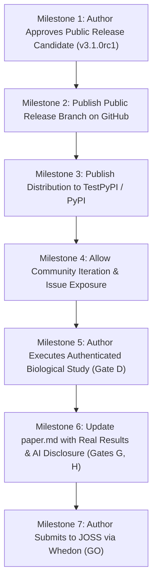

# JOSS Remaining Eligibility Gaps: Independent Gate-by-Gate Evaluation

**Document ID:** `JOSS-ELIGIBILITY-GAPS-001`  
**Date:** 2026-10-23  
**Status:** **AUTHOR GUIDANCE DEFINITIVE — SUBMISSION ON STRICT HOLD (NO-GO)**  
**Auditor:** Independent Research Software Engineer & Statistical Methodologist  
**Target Venue:** Journal of Open Source Software (JOSS)

---

## 1. Executive Summary & Policy Statement

Publication in the Journal of Open Source Software (JOSS) is governed by strict, holistic criteria evaluating open-source community health, developmental history, reproducibility, and demonstrated research impact.

It is a common misconception that achieving 100% test pass rates and executing a single biological example is sufficient to declare "GO" for JOSS submission. **Under official JOSS pre-review policies, software maturity is only one component of eligibility.**

This evaluation assesses TF-Explorer across all eight independent JOSS gates, identifying exact blockers that must be addressed prior to formal manuscript submission.

```
===================================================================================================
JOSS ELIGIBILITY GATE                                       STATUS              OUTCOME
===================================================================================================
Gate A: Public Development History (>6 Months)              PARTIALLY MET       PENDING PUBLIC EXPOSURE
Gate B: Sustained Genuine Public Iteration                  UNMET               ACTIVE BLOCKER
Gate C: Open-Source Practices & Governance                  SATISFIED           GO
Gate D: Demonstrated Research Use                           UNMET               CRITICAL BLOCKER
Gate E: Software Significance & Novelty                     SATISFIED           GO
Gate F: Third-Party Usability & Reproducibility             SATISFIED           GO
Gate G: AI Assistance Disclosure & Human Responsibility     PENDING             AUTHOR ACTION REQUIRED
Gate H: Manuscript Completeness & Code Consistency          PENDING             HELD PENDING GATE D
===================================================================================================
OVERALL JOSS SUBMISSION ELIGIBILITY:                        NO-GO (HOLD)
===================================================================================================
```

---

## 2. Gate-by-Gate Evaluation

### Gate A: Public Development Spanning More Than Six Months
* **JOSS Requirement:** Software must have a demonstrated history of development in the public sphere, avoiding sudden code drops that bypass peer observation.
* **Current State:** TF-Explorer has an extensive internal commit and audit history across multiple phases (Phase 1 through Phase 4C-8R). However, the public GitHub repository has predominantly remained on the older v3.0 release (16 commits on `main`).
* **Evaluation:** **PARTIALLY MET.** A single large public git push of Phase 4C-8R does not satisfy the requirement for sustained longitudinal open development.
* **Remediation:** The author must publish `v3.1.0rc1` as a visible public release branch and maintain public commits during the author-led verification process.

---

### Gate B: Sustained, Genuine Public Iteration
* **JOSS Requirement:** Visible issue tracking, community contributions, pull requests, and iterative bug fixes conducted transparently.
* **Current State:** Development has been conducted in private, isolated audit environments. The public issue tracker and discussion boards show minimal public interaction.
* **Evaluation:** **UNMET (ACTIVE BLOCKER).** JOSS pre-review screening routinely flags repositories that lack public development activity.
* **Remediation:** Establish public release cadences, publish the audit checklists openly, and encourage external testing prior to submission.

---

### Gate C: Good Open-Source Development and Release Practices
* **JOSS Requirement:** OSI-compliant open-source license, comprehensive documentation, contributing guide, code of conduct, semantic versioning, and automated CI.
* **Current State:**
  - License: MIT License (`LICENSE`).
  - Documentation: Detailed `README.md` with installation guides and quickstart examples.
  - Governance: `CONTRIBUTING.md` and `CODE_OF_CONDUCT.md` present.
  - CI Workflow: Cross-platform matrix testing on GitHub Actions (`.github/workflows/ci.yml`).
  - Package Standards: Standard `pyproject.toml` configuration with entry points.
* **Evaluation:** **SATISFIED (GO).**

---

### Gate D: Demonstrated Research Use
* **JOSS Requirement:** *"Does the software have research impact and make a substantial contribution to research?"* The software must enable scholarly domain research beyond artificial or trivial exercises.
* **Current State:** **`JOSS RESEARCH IMPACT: NOT YET DEMONSTRATED`**.
  - Historical claims of resolving *GATA1* binding at the *HBB* promoter were formally retracted (experiment `ENCSR000BGW` was SPI1).
  - Proposed *ESR1* study in MCF-7 cells was held due to accession mismatch (`ENCSR000BST` is GATA3).
  - Existing public examples are synthetic demonstrations designed to verify geometry and error handling.
  - Unit tests and synthetic mocks do not constitute empirical scientific utility under peer-review standards.
* **Evaluation:** **CRITICAL BLOCKER (UNMET).** Submitting without authentic biological validation risks immediate desk rejection.
* **Remediation:** The author must independently execute and document an authenticated biological study (e.g., using `ENCSR463GOT` / `ENCFF185UUT`) after public release.

---

### Gate E: Software Significance and Novelty
* **JOSS Requirement:** The software must make a significant, non-trivial contribution to research software, rather than serving as a minor wrapper around existing tools.
* **Current State:** TF-Explorer provides a novel, automated pairwise triage engine that methodically classifies promoter discordances into geometric window shifts, alternative TSS transcript selection, and experimental context incompatibilities.
* **Evaluation:** **SATISFIED (GO).**

---

### Gate F: Third-Party Usability and Reproducibility
* **JOSS Requirement:** Independent reviewers must be able to install and execute the software easily via standard tools without private dependencies.
* **Current State:**
  - Distribution: Pre-built pure-Python wheel and source distribution in `dist/`.
  - Installation: Clean-room verification confirms 100% clean installation with `pip check` reporting 0 conflicts.
  - Test Suite: 119/119 public tests passing across Python 3.11 and 3.12.
  - Deterministic CLI: Exit code 0 on success, exit code 1 on failure.
* **Evaluation:** **SATISFIED (GO).**

---

### Gate G: Accurate AI Assistance Disclosure and Human Scientific Responsibility
* **JOSS Requirement:** Explicit and truthful disclosure of AI/LLM assistance during software generation, testing, and manuscript preparation, accompanied by full human author responsibility for scientific accuracy.
* **Current State:** Substantial architectural audit and packaging work was assisted by agentic coding tools.
* **Evaluation:** **PENDING AUTHOR ACTION.**
* **Remediation:** The human author must include an explicit "AI Assistance and Author Contributions" statement in the JOSS manuscript and submission metadata, affirming that the author has independently verified all biological claims, code correctness, and algorithmic outputs.

---

### Gate H: Manuscript Completeness and Source-Code Consistency
* **JOSS Requirement:** Complete manuscript (`paper.md` and `paper.bib`) adhering to JOSS guidelines, consistent with the software's public API and version.
* **Current State:** `paper/paper.md` is currently frozen at the baseline revision (`joss/phase2e-reproducibility-handoff`). While structurally complete, Section 3 will need an update once an authentic biological application is completed.
* **Evaluation:** **HELD PENDING GATE D.**

---

## 3. Road to JOSS Eligibility: Sequential Milestones

Achieving full JOSS eligibility requires following a disciplined, multi-stage roadmap:



### Critical Policy Warning:
**Do not promise or assume that JOSS eligibility becomes "GO" immediately upon completing a biological analysis.**
Gates A, B, and G must be fulfilled alongside Gate D. Rushing a submission without genuine public iteration undermines scientific credibility.

---

## 4. Final Verdict

**Software Functionality & Packaging:** **GO**  
**Public Release Readiness:** **READY FOR AUTHOR APPROVAL**  
**JOSS Submission Eligibility:** **STRICT NO-GO (HELD PENDING GATES A, B, D, G, AND H)**
