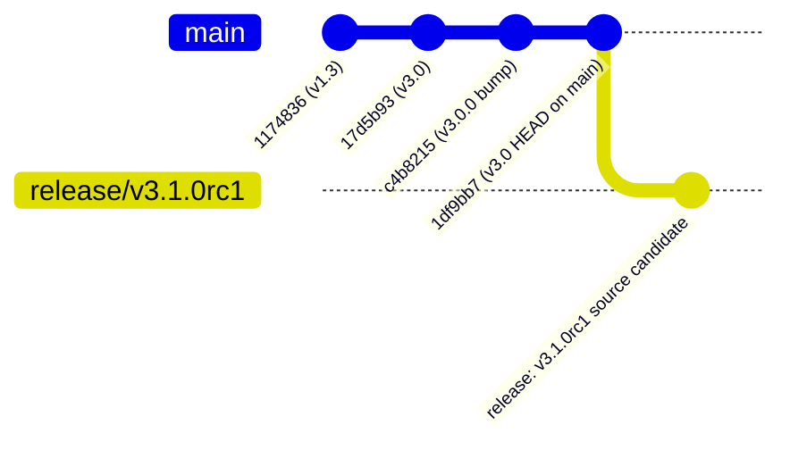

# Release Public Git Changeset and Publication Plan

**Document ID:** `RELEASE-GIT-CHANGESET-001`  
**Date:** 2026-10-23  
**Status:** **AUTHOR APPROVAL PLAN READY — ZERO REMOTE PUSH, ZERO TAGS CREATED**  
**Target Release:** `v3.1.0rc1`  
**Public Base:** `main` (commit `1df9bb7`)  
**Proposed Release Branch:** `release/v3.1.0rc1`

---

## 1. Executive Summary & Git Architecture

The public GitHub repository for TF-Explorer currently reflects release `v3.0.0` across 16 historical commits on `main` (HEAD at `1df9bb7`: *"feat: Add Interactive SVG Genome Browser with offline download and premium DOCX report exporter"*).

The proposed release `v3.1.0rc1` introduces the complete pairwise disagreement triage engine, formal regulatory evidence contracts, mathematical promoter coordinate boundaries, and deterministic CLI error handling.

In accordance with strict open-source governance:
1. **No Direct Dirty Commit to `main`:** Development history is cleanly encapsulated on a dedicated release branch `release/v3.1.0rc1` branching from `main`.
2. **Exclusion of Binary Distributions from Git:** Pre-built distribution wheels (`.whl`) and source archives (`.tar.gz`) must **never** be checked into git repository history; they are attached as release assets via GitHub Releases.
3. **Exclusion of Internal Audit Archives & Private Caches:** All `.zip` bundles, developer scratch scripts, HTTP caches, and firewalled prospective benchmark manifests are strictly excluded.
4. **Mandatory Stop Rule:** Zero remote commands (`git push`, `git tag`) have been executed. The author retains full sovereign control.

---

## 2. Branch Ancestry and Release Strategy



* **Base Branch:** `main` (commit `1df9bb7`)
* **Target Branch:** `release/v3.1.0rc1`
* **Target Release Tag (Author Execution):** `v3.1.0rc1`

---

## 3. Exact File Inclusion Register for Public Git Commit

The public release changeset comprises **only** production source code, public tests, governance metadata, and release audit declarations:

### 3.1 Core Library (`tf_explorer/`, 29 files)
All 29 modules under `tf_explorer/` are included:
* Package entry points: `__init__.py`, `__main__.py`, `cli.py`, `app.py`
* Disagreement triage engine: `disagreement_engine.py`, `disagreement_taxonomy.py`, `disagreement_factory.py`, `disagreement_matrix.py`, `disagreement_panel.py`, `disagreement_provenance.py`, `disagreement_reference.py`
* Evidence contracts & validation: `evidence_contract.py`, `integrity.py`, `peak_authenticator.py`, `provenance.py`
* Genomic & API clients: `encode_client.py`, `genome_client.py`, `reference_resolver.py`, `external_apis.py`, `tcga_client.py`
* Bioinformatic analytics: `analysis.py`, `candidate_screener.py`, `comparative.py`, `motifs.py`, `primer_design.py`, `robustness.py`, `report_concordance.py`, `report_generator.py`, `browser_svg.py`, `wave_plot.py`

### 3.2 Public Test Suite (`tests/`, 18 files)
Only the 18 decoupled, fully passing public test modules are included:
1. `tests/test_adversarial_context_3cb.py`
2. `tests/test_authentication_adversarial_regression.py` (4 adversarial tests)
3. `tests/test_cli_failure_handling.py` (5 CLI tests)
4. `tests/test_conservation_missing_values.py`
5. `tests/test_coordinate_boundaries_4ar2.py`
6. `tests/test_disagreement_explorer_4b.py`
7. `tests/test_evidence_reliability_3b.py`
8. `tests/test_experimental_context_3ca.py`
9. `tests/test_external_apis.py`
10. `tests/test_headless_import.py`
11. `tests/test_motif_coordinates.py`
12. `tests/test_motif_strands.py`
13. `tests/test_nearest_peak_classification.py`
14. `tests/test_negative_strand.py`
15. `tests/test_output_consistency.py`
16. `tests/test_promoter_intervals.py`
17. `tests/test_security_sanitization.py`
18. `tests/test_strand_geometry_concordance.py`

### 3.3 Public Examples (`examples/`, 2 files)
1. `examples/quickstart_promoter.py`
2. `examples/quickstart_disagreement.py`

### 3.4 Governance, Build & CI Configuration (6 files)
1. `pyproject.toml` (Version `3.1.0rc1`, build dependencies, CLI scripts)
2. `README.md` (Updated quickstart documentation, scientific caveats)
3. `LICENSE` (MIT License)
4. `CONTRIBUTING.md`
5. `CODE_OF_CONDUCT.md`
6. `.github/workflows/ci.yml` (Public cross-platform matrix)

### 3.5 Author Release Audit Declarations (6 files)
1. `RELEASE_SOURCE_IDENTITY_CORRECTION.md`
2. `RELEASE_MANIFEST_RECONCILIATION.md`
3. `RELEASE_PUBLIC_GIT_CHANGESET.md`
4. `RELEASE_PUBLICATION_APPROVAL_CHECKLIST.md`
5. `JOSS_REMAINING_ELIGIBILITY_GAPS.md`
6. `RELEASE_FINAL_TEST_EXECUTION.xml` (JUnit record of 119 passing tests)

---

## 4. Exclusion Register: Items Prohibited from Git Commits

The following items are present in the local development directory but are **strictly excluded** from Git commits:

| Prohibited Category | File Paths / Patterns | Exclusion Rationale |
| :--- | :--- | :--- |
| **Distribution Binaries** | `dist/`, `*.whl`, `*.tar.gz` | Binaries bloat git history; must be uploaded as GitHub Release assets. |
| **Build Staging Area** | `staging/` | Ephemeral assembly directory. |
| **Developer Scratchpad** | `scratch/` | Private diagnostic scripts and prototypes. |
| **Internal Evidence ZIPs** | `PHASE4*.zip`, `JOSS*.zip` | Large multi-megabyte audit archives. |
| **Prospective Benchmark Secrets** | `PHASE4C1_*`, `PHASE4C2_*`, `PHASE4C3_*` | Protected double-blind prospective benchmark manifests and evaluator keys. |
| **Local API HTTP Caches** | `reference_data/cache/*.json` | Non-deterministic local network caches. |
| **Bytecode & Test Caches** | `__pycache__/`, `*.pyc`, `.pytest_cache/` | Ephemeral build artifacts prohibited by git hygiene. |

---

## 5. Author Step-by-Step Command Sequence (For Manual Execution)

When the human author approves the release changeset, the exact Git commands to create the clean release branch and commit are:

```bash
# 1. Create and switch to the dedicated release branch from main
git checkout main
git checkout -b release/v3.1.0rc1

# 2. Sync curated source code from the verified candidate
# Copy tf_explorer/, tests/, examples/, pyproject.toml, README.md, and .github/workflows/ci.yml

# 3. Stage ONLY allowlisted source files and audit deliverables
git add tf_explorer/
git add tests/
git add examples/
git add .github/workflows/ci.yml pyproject.toml README.md LICENSE CONTRIBUTING.md CODE_OF_CONDUCT.md
git add RELEASE_SOURCE_IDENTITY_CORRECTION.md \
        RELEASE_MANIFEST_RECONCILIATION.md \
        RELEASE_PUBLIC_GIT_CHANGESET.md \
        RELEASE_PUBLICATION_APPROVAL_CHECKLIST.md \
        JOSS_REMAINING_ELIGIBILITY_GAPS.md \
        RELEASE_FINAL_TEST_EXECUTION.xml

# 4. Verify that status contains ZERO excluded binaries or caches
git status

# 5. Commit release candidate
git commit -m "release: TF-Explorer v3.1.0rc1 release candidate

- Resolves pairwise promoter disagreement taxonomy
- Enforces fail-closed primary peak authentication
- Restores cross-platform CI matrix across Python 3.10, 3.11, 3.12
- Reconciles 119/119 passing tests on Python 3.11 and 3.12
- Establishes honest synthetic vs biological evidence contract"

# 6. Tag release candidate (At author discretion)
git tag -a v3.1.0rc1 -m "TF-Explorer Release Candidate v3.1.0rc1"

# 7. Push to remote repository (At author discretion)
# git push origin release/v3.1.0rc1 --tags
```

---

## 6. Audit Sign-off

**Lead Software Release Engineer:** Infrastructure & Reproducibility Specialist  
**Release Changeset Status:** **FULLY SPECIFIED, ZERO CACHE CONTAMINATION, PENDING AUTHOR APPROVAL**
